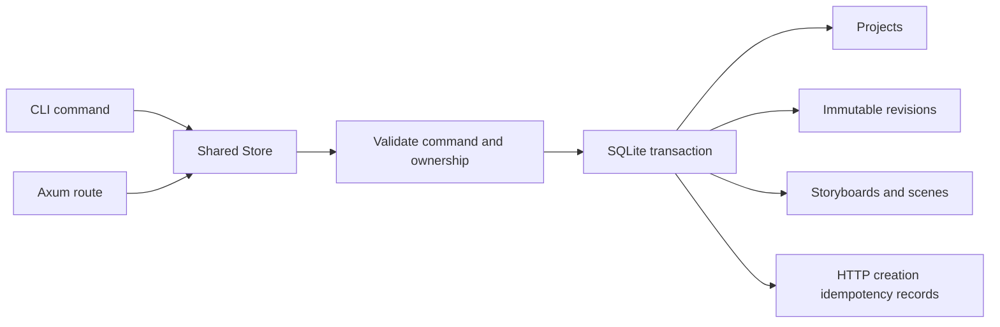
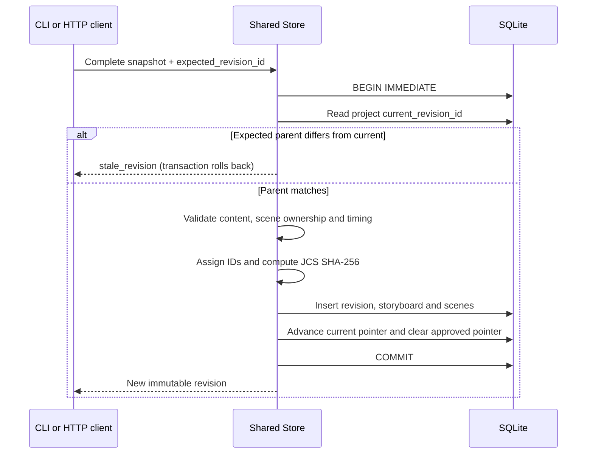
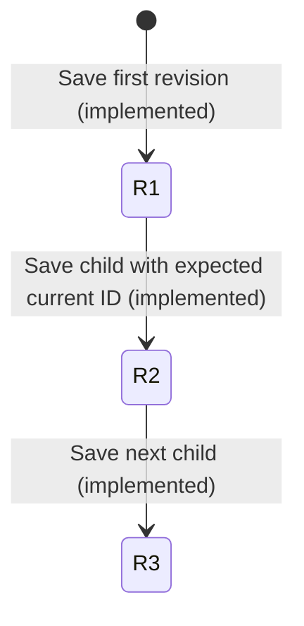
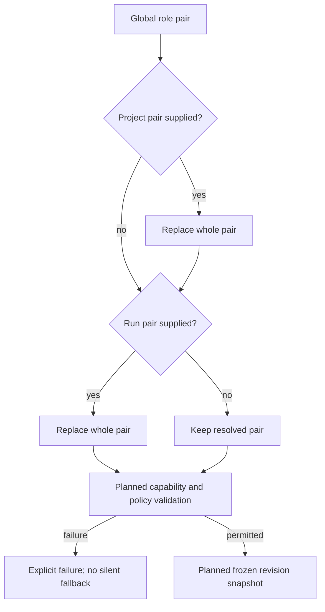
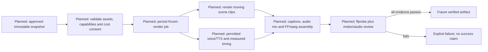

<p></p>

# Scenivox

**A local-first workspace for scene-based video production.**

Keep project data local. Edit complete story revisions without rewriting history. Review and approve an exact revision as editorial evidence; rendering remains a separate, unimplemented gate.

[Get started](#installation-and-quick-start) · [CLI](#cli-usage) · [HTTP API](#http-api) · [Architecture](#architecture-and-data-flow) · [Contributing](#contributing)

> **Current status:** Scenivox implements local project/revision persistence, deterministic offline storyboard planning, model-selection metadata, and hash-bound editorial review/approval through a Rust CLI and HTTP API. Planning uses a deterministic mock; it does not invoke a model or network. Approval records editorial evidence only; it does not authorize rendering, paid access, or skill execution. P2-02 adds bounded local PCM WAV validation and pure scene timing; it does not synthesize or verify Indonesian speech. Rendering, audio production, captions, and video export remain unimplemented or unverified.

## Contents

- [Purpose and audience](#purpose-and-audience)
- [What works today](#what-works-today)
- [Architecture and data flow](#architecture-and-data-flow)
- [Planned product workflow](#planned-product-workflow)
- [Technology stack](#technology-stack)
- [Installation and quick start](#installation-and-quick-start)
- [CLI usage](#cli-usage)
- [HTTP API](#http-api)
- [Configuration and data](#configuration-and-data)
- [Project structure](#project-structure)
- [Testing and CI](#testing-and-ci)
- [Security and trust boundaries](#security-and-trust-boundaries)
- [Known limitations and roadmap](#known-limitations-and-roadmap)
- [FAQ](#faq)
- [Contributing](#contributing)
- [Technical references](#technical-references)
- [License](#license)

## Purpose and audience

Scenivox is being developed for creators who want an editable scene-based workflow for short-form video, with control over story revisions before any future costly generation or render step. The intended product is local-first and single-user initially, rather than a hosted multi-tenant service.

The product vision is idea → structured scenes and narration → human revision → approval of an exact revision → an audited animated-media pipeline. The target is portrait 9:16 video, with Indonesian narration and synchronized captions. A roughly 60-second, 1080×1920, 30 fps output is a goal to verify against a real engine, not an implemented capability or compatibility promise.

**Today this repository provides project/revision persistence, local model selection, deterministic offline storyboard planning, and review/approval of immutable revisions.** The planner does not invoke models. Approval is not render authorization; the repository does not yet render scenes or export a playable MP4. The included visual assets are supplied project artwork, not application screenshots or evidence of generated media.

## What works today

| Capability | Current behavior | Boundary |
|---|---|---|
| Projects | Create, read, list, rename, soft-delete | Deletion hides reads; stored rows remain and there is no restore command |
| Revisions | Save and read complete, manually supplied content snapshots | Every save creates a new immutable record |
| Storyboards and scenes | Generate deterministic offline drafts and persist ordered scenes inside immutable revisions | No remote model inference or visual editor |
| Integrity | Validate ownership, ordering and exact duration sum; create stable scene IDs; compute RFC 8785 JCS/SHA-256 content hashes | Hashes do not prove inference or rendering took place |
| Concurrency | Serialize revision writes and reject a stale expected parent | This protects the current SQLite write path; it is not a distributed service |
| Review and approval | Hash-bound draft → in_review → approved workflow; separate mutable review state and append-only evidence | Editorial only; no render authorization, identity assertion or paid operation |
| Interfaces | Axum HTTP routes and one-shot Clap CLI use shared persistence services | No authentication; default server bind is loopback |
| Model metadata | Local registry and effective selections resolve run > project > global with role/capability validation | No provider adapter, probe or inference |
| Media | Read-only local PCM WAV validation and pure scene timing only | No TTS/alignment provider, captions without measured spans, renderer, or export route |

Project data uses a 1 MiB strict JSON input boundary; duplicate JSON keys and unknown fields are rejected. Current revision constraints include `id-ID`, `9:16`, 30 fps, 1–60,000 ms total duration and 1–60 scenes. Scene order is zero-based and contiguous, and scene durations must sum exactly to the target. These are data-contract constraints, **not verified renderer limits**.

Each revision is a complete snapshot: edits create a child revision and move the project's current pointer. Supplied provider/model/prompt/skill metadata is not evidence that those systems ran. Asset hashes are inert metadata; nonempty SFX cues are rejected because there is no asset registry.

## Architecture and data flow

This diagram shows implemented request paths only. There is no separate API service or rendering worker in the current application.



### Revision save data flow



### Revision lifecycle: current implementation and planned rendering

Revision creation, history, review and editorial approval are implemented. Render authorization and media workflow are future specifications only.



Storyboard generation, draft persistence, model selection resolution, review and editorial approval are implemented. The downstream render and media workflow remains planned; approval alone does not authorize rendering.

The following sequence shows the implemented draft boundary and planned downstream work. It is not a runnable end-to-end media capability.

```mermaid
flowchart TD
    IDEA[Creator idea] --> PLAN[Deterministic offline storyboard planner (implemented)]
    PLAN --> SAVE[Immutable revision with frozen prompt inputs (implemented)]
    SAVE --> EDIT[Create child revision (implemented)]
    EDIT --> REVIEW[Human review and editorial approval (implemented)]
    REVIEW --> MODEL[Planned: validate model, skill, asset and cost policy]
    MODEL --> JOB[Planned: durable render job]
    JOB --> PIPE[Planned: animation, voice, captions and assembly]
    PIPE --> QA[Planned: media probes and human quality review]
    QA --> MP4[Unverified goal: playable animated MP4]
```

### Model routing contract

The specification defines `storyboard_planning` and `scene_code_generation` as separate model roles. Resolution uses run > project > global precedence and validates local model role/capability metadata. The planner freezes effective model snapshots but currently executes only the deterministic offline mock; no model provider is invoked.



The two roles do not imply TTS or video generation. Saving selection metadata does not authorize inference or a paid request. See the [model contract](technical-docs/MODEL_CONTRACT.md).

### Rendering pipeline contract (planned)



No part of this media diagram is currently wired into the application. The candidate skill and its dependencies require independent audit; a process exiting successfully or a static slideshow is not media acceptance evidence.

## Technology stack

| Component | Responsibility | Status |
|---|---|---|
| Rust 2024 | Single-crate domain and binary | Implemented |
| Axum + Tokio | HTTP transport and async runtime | Implemented |
| SQLx + SQLite | Embedded migrations, local records and transactions | Implemented |
| Serde + serde_json | Strict request and response types | Implemented |
| Clap | Local project/revision CLI | Implemented |
| UUID + serde_jcs + SHA-256 | Server-owned IDs and canonical revision hashes | Implemented |
| Local audio/timing | Bounded PCM WAV inspection and pure 30 fps scene timing | Interfaces are extensible; no TTS/aligner is installed; Indonesian speech/pronunciation unverified |

Versions are pinned in [Cargo.toml](Cargo.toml) and [Cargo.lock](Cargo.lock). OMP is used during development only; it is not required by the Scenivox runtime. See [technology rationale](technical-docs/TECH_STACK.md).

## Installation and quick start

### Requirements

- Git and the Rust stable toolchain with Cargo (`rust-toolchain.toml` selects stable; the manifest declares Rust 1.85 as `rust-version`).
- A native C compiler/linker may be needed for SQLx's bundled SQLite build, depending on target.
- No provider credentials, Node, Python, Chromium, FFmpeg or third-party skill is required for the current persistence backend.

### Build and run

```sh
git clone https://github.com/RahmatHadinata23758051/Scenivox.git
cd Scenivox
cargo build --locked
cargo run --locked -- serve
```

The no-subcommand form, `cargo run --locked`, also starts the API. Startup applies the SQLite migrations before binding to the default loopback address. Then check:

```sh
curl http://127.0.0.1:3000/health
```

The endpoint always returns HTTP 200. Inspect the body: `{"status":"ok"}` means the SQLite query succeeded; `{"status":"unavailable"}` means it did not. This is not a readiness endpoint. The database file is created in the working directory; parent directories for custom database paths must already exist.

More details: [backend setup](technical-docs/SETUP.md).

## CLI usage

Most one-shot commands read/write the configured SQLite database directly; the API server need not be running. `voice inspect` is an exception: it needs no database, takes one explicit relative WAV path, and reads only a file resolving inside the current working directory. Success is JSON on stdout; failures use a safe JSON envelope on stderr and a nonzero exit status.

```sh
# Create a project from the checked-in example
cargo run --locked -- project create --file tests/fixtures/p1-project.json
cargo run --locked -- project list --limit 20

# Substitute the returned UUIDs for these placeholders
cargo run --locked -- revision create PROJECT_ID --file tests/fixtures/p1-revision.json
cargo run --locked -- revision list PROJECT_ID --limit 20
cargo run --locked -- revision get PROJECT_ID REVISION_ID
```

Available commands:

```text
scenivox project create --file PATH
scenivox project get ID
scenivox project list [--limit N] [--cursor ID]
scenivox project update ID --file PATH
scenivox project delete ID
scenivox revision create PROJECT --file PATH
scenivox revision get PROJECT REVISION
scenivox revision list PROJECT [--limit N] [--cursor ID]
scenivox storyboard generate PROJECT --file PATH
scenivox revision review PROJECT REVISION --file PATH
scenivox revision withdraw-review PROJECT REVISION --file PATH
scenivox revision approve PROJECT REVISION --file PATH
scenivox voice inspect --file PATH
```

`voice inspect` supports integer PCM WAV only (mono/stereo, 8–192 kHz, 8/16/24/32-bit, 1–60 seconds, at most 64 MiB). It reports format, frame count, duration, and SHA-256; it neither synthesizes speech nor generates captions. It performs no network call, database write, or render dispatch. Audio metadata is separate from immutable revisions. No locally installed, appropriately licensed Indonesian TTS engine was identified during P2-02; Indonesian voice quality and pronunciation verification remain pending.

Lists default to 20 entries; valid limits are 1–100. Use the returned `next_cursor` as the next page's `--cursor`. Project deletion soft-hides its history but retains rows; CLI delete returns JSON `null`. Use `cargo run --locked -- --help` for help.

For a revision edit, submit the complete `CreateRevision` command: version, expected current revision UUID, and full content snapshot. Preserve IDs for scenes retained from the current parent; omit or null IDs for new scenes. The fixture is for a first revision and becomes stale after that first save. See [domain types](src/domain.rs) and [API contract](technical-docs/API_CONTRACT.md).

## HTTP API

Implemented routes:

| Method | Route | Behavior |
|---|---|---|
| GET | `/health` | Legacy database diagnostic; inspect response body |
| GET, POST | `/v1/projects` | List projects; create project |
| GET, PATCH, DELETE | `/v1/projects/{id}` | Read, title-only rename, soft-delete |
| GET, POST | `/v1/projects/{id}/revisions` | List or create immutable revisions |
| POST | `/v1/projects/{id}/storyboard:generate` | Generate deterministic offline draft and persist as an immutable revision |
| GET, PATCH | `/v1/projects/{id}/revisions/{rid}` | Read a revision or save a replacement as a new revision |
| POST | `/v1/projects/{id}/revisions/{rid}/review` | Move draft revision to in_review; requires exact content hash and Idempotency-Key |
| POST | `/v1/projects/{id}/revisions/{rid}/withdraw-review` | Return in_review revision to draft; requires exact content hash and Idempotency-Key |
| POST | `/v1/projects/{id}/revisions/{rid}/approve` | Append approval evidence for current in_review revision; requires exact content hash and Idempotency-Key |
| GET | `/v1/projects/{id}/approvals/{aid}` | Read immutable approval evidence |
Project creation example (requires a fresh canonical UUID idempotency key for a distinct operation):

```sh
curl -i -X POST http://127.0.0.1:3000/v1/projects \
  -H 'Content-Type: application/json' \
  -H 'Idempotency-Key: 3d8ce80e-93a1-4eb3-9613-e4b7b76f2a10' \
  --data-binary @tests/fixtures/p1-project.json
```

Creation returns 201 and a `Location` header. Repeating a creation with the same key and body replays the stored response; using that key for a different body returns 409. Revision create likewise needs an `Idempotency-Key`. Revision PATCH takes a complete revision command and only succeeds when the route revision and expected current parent match; it returns 201 for the newly created revision.

Command requests require `Content-Type: application/json`, are bounded to 1 MiB, and reject duplicate keys, unknown fields and unsupported schema versions. Lists accept `limit` and a UUID cursor referring to a row in that same list. Do not construct cursors manually. The API is unauthenticated; keep it on loopback.

Not implemented: `/ready`, provider probes/inference, review/approval, jobs, render, artifacts and assets. Model registry and selection endpoints are implemented. The [API contract](technical-docs/API_CONTRACT.md) contains future specifications as well as current routes.

## Configuration and data

The process loads `.env` if present. The checked-in [.env.example](.env.example) documents these settings:

| Variable | Default | Purpose |
|---|---|---|
| `SCENIVOX_ADDR` | `127.0.0.1:3000` | HTTP bind address; loopback is the safe local default |
| `SCENIVOX_DATABASE_URL` | `sqlite://scenivox.db?mode=rwc` | SQLite database URL |
| `RUST_LOG` | `info` | Serving log filter |

Example:

```dotenv
SCENIVOX_ADDR=127.0.0.1:3000
SCENIVOX_DATABASE_URL=sqlite://scenivox.db?mode=rwc
RUST_LOG=info
```

The server and CLI must use the same database URL to share data. Migrations run when the database is connected. Back up SQLite data before upgrades; there is no supported restore or down-migration command. Soft-deletion is not secure erasure, and the current application does not encrypt the database.

## Project structure

```text
src/                 Rust entrypoint, CLI, API, contracts and shared Store
migrations/          Embedded SQLite migrations
schemas/v1/          Versioned JSON Schema record definitions
tests/               Contract, persistence, HTTP, CLI and startup tests
technical-docs/      Tracked public technical contracts and setup
docs/                Local ignored planning and audit documents
img/                 Owner-supplied README Visual Pack (WebP)
```

## Testing and CI

```sh
cargo fmt --all -- --check
cargo clippy --locked --all-targets -- -D warnings
cargo test --locked
```

Integration coverage includes migration/reopen behavior, CRUD and cursor pagination, immutable history, validation rollback, exact hash vectors, scene-ID lifecycle, concurrent stale writes, HTTP idempotency/error behavior, startup and real CLI child processes. Schema tests also validate shapes for planned record types; those tests do not implement the associated workflows.

GitHub Actions runs format, clippy and locked tests on Ubuntu without provider credentials or paid calls. Real media acceptance is not covered: it would require measured `ffprobe` output plus visual motion, audio and caption review. See the [test strategy](technical-docs/TEST_STRATEGY.md).

## Security and trust boundaries

This is a local development backend, not a hardened public service. There is no authentication, multi-user authorization, TLS setup or public-hosting assurance. Binding a custom non-loopback address does not add those protections. Protect the database file and backups with operating-system permissions.

Current code uses bounded strict decoding, parameterized SQL, shared ownership validation, transactional stale-write checks, server-generated identifiers and safe error messages. These controls are not a security certification or complete audit.

Future execution must treat skill archives and AI-generated code as untrusted. `SKILL.md` instructions are not an executable plugin. Before any third-party code runs, review provenance, licenses, install hooks, network and filesystem behavior. A controlled subprocess is not a sandbox; future adapters need allowlisted executables and arguments, contained working directories, restricted environment, timeouts, output limits and process-tree cleanup. Any remote paid operation requires explicit user authorization; no credentials belong in prompts, logs or snapshots. Details: [skill safety contract](technical-docs/SKILL_SPEC.md).

## Known limitations and roadmap

No release dates are promised. Current implementation status comes from source and tests; remaining work is described in the technical contracts as planned behavior.

1. **Implemented:** project and immutable revision persistence with CLI/HTTP and offline regression coverage.
2. **Planned:** model registry, explicit routing, deterministic mock storyboard planner, revision review/approval and guarded job requests.
3. **Planned and unverified:** audited renderer adapter, Indonesian audio path, captions, durable jobs and real animated MP4 assembly.
4. **Deferred:** recovery/cache extensions and a second rendering skill, based on measured support.
5. **Held:** website UI until a separate design brief and approval.

The target is actual moving video, not a slideshow. No working export, supported media duration, renderer performance, voice quality or caption accuracy is claimed.

## FAQ

**Can I generate a video with this repository now?** No. Current commands persist projects and manually supplied revisions. There is no generator or renderer.

**Do I need provider credentials?** No for current persistence operations. Fixture model IDs are data, not provider calls.

**What happens when I edit a revision?** Save a complete child revision with the expected current ID. The previous content remains immutable; stale parents fail.

**Does deleting a project erase its data?** No. Reads hide it, but stored rows remain. There is no restore or secure-erasure feature.

**Is the API safe to expose publicly?** No such security claim is made. There is no authentication; the default bind is loopback.

**Why is media tooling not in the Rust stack?** Rust owns persistence and future orchestration. The architecture intends to reuse audited native media tools, whose performance and compatibility remain unverified.

## Contributing

Start with the public [technical references](#technical-references) and open issues. Keep changes scoped and reviewable; discuss substantial domain or architecture changes before implementation. Preserve revision immutability and keep persistence rules in the shared Store rather than duplicating them in HTTP and CLI.

For code contributions, run format, clippy and relevant tests. Keep CI offline and independent of paid accounts. Update contracts when behavior changes. Report exact commands and results, security/licensing implications, and do not claim media output without actual media evidence. Do not submit secrets, personal databases, unreviewed executables or assets with unclear rights.

## Technical references

| Reference | Subject |
|---|---|
| [Setup](technical-docs/SETUP.md) | Local server configuration |
| [Architecture](technical-docs/ARCHITECTURE.md) | Current boundary and intended media architecture |
| [API contract](technical-docs/API_CONTRACT.md) | Implemented persistence routes and future endpoint specifications |
| [Domain contract](technical-docs/DOMAIN_CONTRACT.md) | Snapshot, identity and approval invariants |
| [Model contract](technical-docs/MODEL_CONTRACT.md) | Planned provider roles, precedence and cost controls |
| [Technology stack](technical-docs/TECH_STACK.md) | Component responsibilities and rationale |
| [Skill specification](technical-docs/SKILL_SPEC.md) | Third-party execution and media acceptance gates |
| [Test strategy](technical-docs/TEST_STRATEGY.md) | Automated checks versus real media QA |
| [Versioned schemas](schemas/v1/contracts.schema.json) | JSON record shapes, not a complete OpenAPI request schema |

## License

No official project software license is present in the repository. Source visibility does not grant permission to redistribute the project or third-party skill/media assets. License selection and asset rights remain open.

## Project visuals

The following artwork is the **owner-supplied Visual Pack**. It illustrates the project; it is not an application screenshot, generated storyboard, timeline output or proof of video functionality.


[Back to top](#scenivox)
