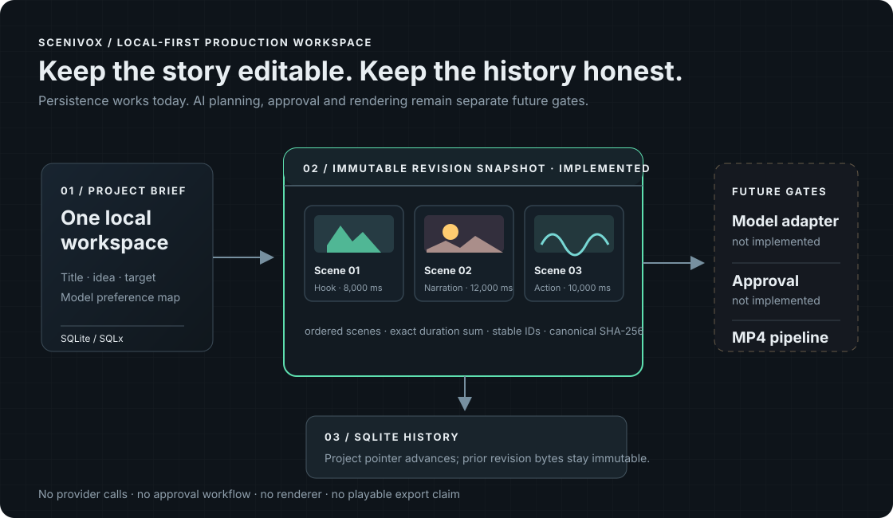
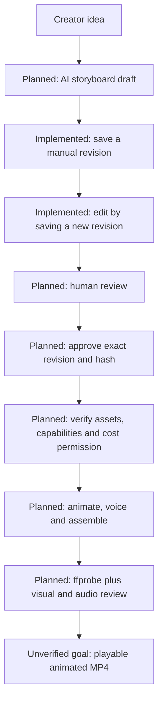
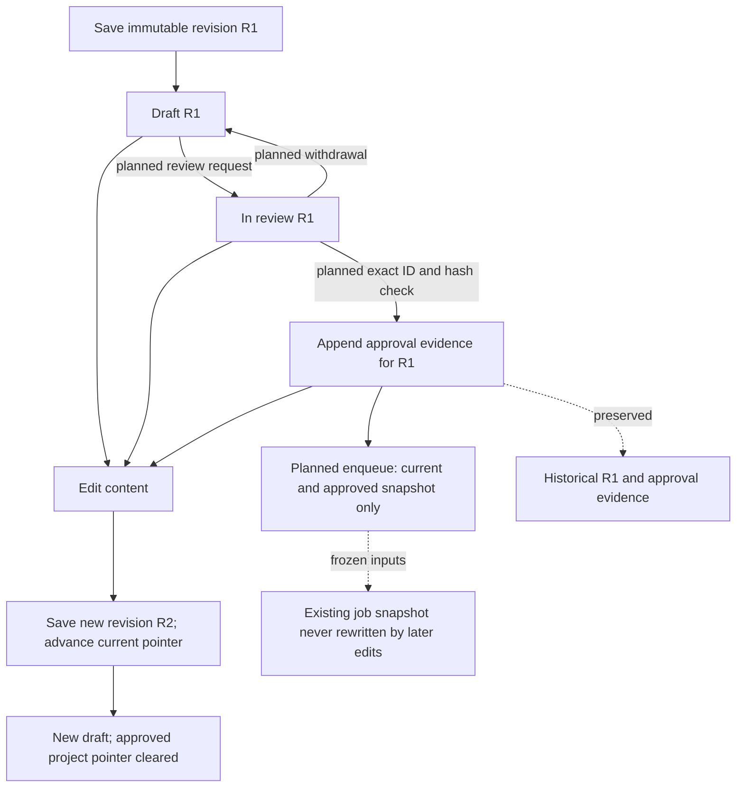
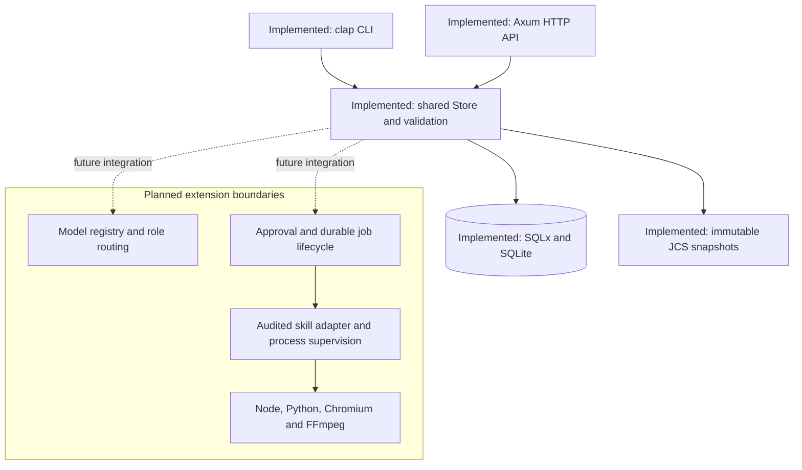
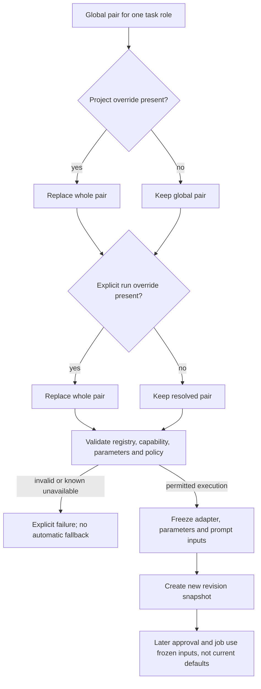
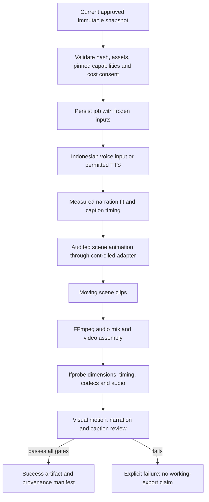

<p></p>

# Scenivox

**Your story, scene by scene. A history you can trust.**

A local-first foundation for a model-agnostic video studio: structure the story, preserve every revision, and keep creative control before execution.

[Get started](#installation) · [Try the CLI](#cli-usage) · [API reference](#http-api) · [Architecture](#architecture) · [Contribute](#contributing)



> **What works today:** local project CRUD and manual storyboard/revision persistence through Rust CLI and HTTP interfaces. **What does not:** AI planning, model routing, approval, render jobs, TTS, captions, or video export. Scenivox is not yet a working video generator. The illustration is conceptual artwork, not a product screenshot or rendered-video sample.

## Contents

- [Vision](#vision)
- [Capabilities and maturity](#capabilities-and-maturity)
- [Workflows](#workflows)
- [Architecture](#architecture)
- [Technology stack](#technology-stack)
- [Installation](#installation)
- [CLI usage](#cli-usage)
- [HTTP API](#http-api)
- [Configuration and data](#configuration-and-data)
- [Testing and verification](#testing-and-verification)
- [Security and trust boundaries](#security-and-trust-boundaries)
- [Roadmap](#roadmap)
- [FAQ](#faq)
- [Contributing](#contributing)
- [Technical library](#technical-library)
- [License and artwork](#license-and-artwork)

## Vision

Scenivox is being built for creators who want to turn an idea into animated short-form video without handing over editorial control to a single model or opaque generation step.

The intended workflow starts with a structured storyboard: a synopsis, a hook, ordered scenes, narration, camera direction, action, and exact timing. A creator edits that story, then approves a specific immutable revision before a controlled media pipeline runs. Provider choices, skill versions and input hashes should remain traceable rather than changing underneath an approved project.

The initial media goal is a roughly 60-second portrait video with **actual moving scenes**, Indonesian narration and synchronized captions. The intended output is 9:16, targeting 1080×1920 at 30 fps **only when verified on the selected engine**. Neither schema limits nor a successful HTTP response prove media quality. Photorealistic text-to-video is not promised.

The current deliverable is the persistence foundation for that workflow, not the complete studio. No website, accounts, subscription service, or hosted SaaS is implemented.

## Capabilities and maturity

| Area | Available now | Planned or unverified |
|---|---|---|
| Projects | Create, read, list, rename and soft-delete | Restore and multi-user workspaces are not available |
| Storyboards | Save complete, manually supplied scene snapshots | AI-generated drafts and interactive editing UI |
| Revision history | Immutable snapshots, parent links, project-local versions and SHA-256 content hashes | Review and approval workflow |
| Consistency | Transactional stale-write rejection, scene ownership checks, exact timing validation | Approval and render enqueue gates |
| Interfaces | Local Axum HTTP API and one-shot Rust CLI over the same Store | Model, planning, approval, job and artifact commands |
| Models | Persist supplied preference maps and role snapshots as data | Registry, default resolution, capability checks and inference adapters |
| Media | No renderer or export endpoint | Audited animation, Indonesian voice, captions, FFmpeg assembly and real QA |
| Verification | SQLite reopen, concurrency, validation, HTTP, CLI and schema tests | Full video acceptance, resource benchmarks and media portability |

### Persistence guarantees

- **Every content edit is a new revision.** Historical revisions, storyboards and scene rows have database update/delete blockers. A project title change does not rewrite a snapshot.
- **No silent lost update.** Revision writes serialize with SQLite `BEGIN IMMEDIATE` and compare the supplied expected revision against the current pointer. A competing stale write fails.
- **Stable scene identity.** New scenes receive server UUIDs. Retained IDs must belong to the immediate parent; removed IDs cannot be resurrected in a later revision.
- **Strict structure and timing.** Unknown fields/versions and duplicate JSON keys fail. Current v1 scope is `id-ID`, `9:16`, `30` fps, `1..60000` ms and `1..60` scenes. Scene order is zero-based and contiguous; scene durations must sum exactly to the target.
- **Canonical integrity.** Revision content is RFC 8785 JCS-serialized and SHA-256 hashed. Scene array order is retained, unique asset hashes are sorted, and Unicode is not normalized. Revision envelope ID, version and time are outside the content hash; scene IDs remain inside it.
- **Durable HTTP replay.** Creation POSTs persist an operation/project-scoped idempotency key, canonical request hash and response in the same transaction.

These guarantees concern stored data. Supplied model, prompt and skill metadata are **not proof that inference or rendering occurred**. Hashes establish integrity, not guaranteed bit-for-bit reproducibility of future remote model outputs.

## Workflows

### The intended idea-to-video journey

Only the manual project/revision persistence part below is implemented. Every downstream step is planned; this is not an executable end-to-end tutorial.



### Revision and approval boundary

Current revision creation advances the project pointer while preserving history. The review/approval states below are the **future contract**, not implemented status fields on a revision. Creative approval and permission to incur cost are separate gates.



Approval does not transfer just because two revisions have the same hash. Future enqueue must verify the requested revision is current and approved; it cannot resolve fresh models or silently alter inputs. See the [domain contract](docs/DOMAIN_CONTRACT.md).

## Architecture

One Rust application owns local state and orchestration. The current source is a single crate, with thin HTTP/CLI adapters calling shared domain persistence. OMP is a **development harness**, not a runtime dependency.



The dashed connections mark unimplemented integration, not optional fallback code. Rust owns projects, revisions and future policy; existing media runtimes should do the rendering rather than being rewritten in Rust. No Redis, Celery, separate FastAPI service, or distributed worker infrastructure is required by the current design.

### Model routing contract

**Planned, not implemented.** The two roles are `storyboard_planning` and `scene_code_generation`; TTS is separate. Resolve each role independently using **global < project < run**, replacing the complete provider/model pair at each override layer.



Saving preferences does not authorize inference or a connection probe. Remote availability must not be fabricated; any potentially paid operation needs explicit permission and budget. A consumer chat subscription is not evidence of callable API access. Details: [model contract](docs/MODEL_CONTRACT.md).

### Rendering pipeline contract

**Entirely planned; output capability remains unverified.** The candidate skill is third-party code with separate security and licensing gates. The sequence is a target design, not evidence that these tools are wired into Scenivox.



The planned job stages are `queued → preparing → voicing → animating → mixing → validating → succeeded`. Timeout, process-tree cleanup, restart interruption, cancellation and new-job retry must be proven before this pipeline is accepted. A zero exit code or a static slideshow is insufficient.

## Technology stack

| Layer | Current implementation | Boundary |
|---|---|---|
| Core | Rust, edition 2024 | One crate and application binary |
| HTTP and async runtime | Axum + Tokio | Local API; no frontend |
| Persistence | SQLx + SQLite migrations | Project data and immutable history |
| Data contracts | Serde, serde_json, JSON Schema 2020-12 | Strict commands plus versioned record schemas |
| Identity and integrity | UUID, serde_jcs, SHA-256 | Server IDs and canonical snapshot hashes |
| CLI and diagnostics | clap, tracing, tracing-subscriber | JSON one-shot output; serving logs |
| Test infrastructure | Tower, tempfile, jsonschema | Isolated local tests; no provider account required |

Exact dependency versions are pinned in [Cargo.toml](Cargo.toml) and [Cargo.lock](Cargo.lock). Node/JavaScript, Python, Playwright/Chromium, TTS and FFmpeg are **future adapter dependencies**, not requirements for the current backend. See [stack rationale](docs/TECH_STACK.md).

## Installation

### Prerequisites

- Git and the Rust stable toolchain with Cargo. The manifest declares Rust 1.85 as its minimum; use the repository's [stable toolchain](rust-toolchain.toml) rather than assuming the complete dependency graph was tested at the minimum version.
- A native C compiler/linker for SQLx's bundled SQLite build where required. On Windows this typically means the MSVC build tools for an MSVC Rust target; on Linux use your distribution's native build toolchain.
- No AI credentials, OMP, Node, Python, browser engine, or FFmpeg is needed to run the persistence application.

### Build and start

```sh
git clone https://github.com/RahmatHadinata23758051/Scenivox.git
cd Scenivox
cargo build --locked
cargo run --locked -- serve
```

With no subcommand, `cargo run --locked` also starts the API. In another terminal:

```sh
curl http://127.0.0.1:3000/health
```

A healthy database produces `{"status":"ok"}`. **Always inspect the body:** the legacy diagnostic also returns HTTP 200 with `{"status":"unavailable"}` if its database query fails. `/ready` does not exist yet.

The application creates `scenivox.db` in the working directory and applies both migrations before serving. An existing database is migrated, not replaced. For custom database paths, create the parent directory first. Current CI runs on Ubuntu; the P1-01 local verification ran on Windows. This is not a complete OS/media-runtime support matrix. Additional setup notes: [SETUP.md](docs/SETUP.md).

## CLI usage

One-shot commands access the configured SQLite database directly; the HTTP server does not need to be running. Success is JSON on stdout, errors are JSON on stderr with a nonzero exit status. Help uses normal human-readable CLI output.

### Create a project and its first manual revision

Run from the repository root. The checked-in inputs contain sample story data and **mock metadata**, not an executed mock provider.

```sh
cargo run --locked -- project create --file tests/fixtures/p1-project.json
cargo run --locked -- project list --limit 20
```

Copy the returned project UUID, then replace `PROJECT_ID` below with that value:

```sh
cargo run --locked -- project get PROJECT_ID
cargo run --locked -- revision create PROJECT_ID --file tests/fixtures/p1-revision.json
cargo run --locked -- revision list PROJECT_ID --limit 20
cargo run --locked -- revision get PROJECT_ID REVISION_ID
```

Replace `REVISION_ID` with the saved revision's UUID. These are real commands, but the uppercase identifiers are placeholders, not literal arguments.

### Rename a project

Save this as `rename.json`:

```json
{"schema_version":"1","title":"Underground mystery: revised title"}
```

```sh
cargo run --locked -- project update PROJECT_ID --file rename.json
```

### Save the next revision

A save command contains `schema_version`, `expected_revision_id`, and the complete `content` snapshot. Start with [the revision fixture](tests/fixtures/p1-revision.json), set `expected_revision_id` to the current revision UUID, and edit the content. For each retained scene, use its UUID from the previous response; omit or set `id` to `null` only for genuinely new scenes. Submit the new file with `revision create`.

The first save expects a null parent. Subsequent saves must match the current pointer or fail with `stale_revision`. Saving never updates the previous revision in place. Required content includes idea, target, storyboard, both role snapshots, asset hashes and skill metadata; see [command types](src/domain.rs) and the [API contract](docs/API_CONTRACT.md).

### Command index

```text
scenivox serve
scenivox project create --file PATH
scenivox project get ID
scenivox project list [--limit N] [--cursor ID]
scenivox project update ID --file PATH
scenivox project delete ID
scenivox revision create PROJECT --file PATH
scenivox revision get PROJECT REVISION
scenivox revision list PROJECT [--limit N] [--cursor ID]
```

Use `cargo run --locked -- --help` or `cargo run --locked -- revision --help`. Lists default to 20, accept limits 1 through 100, and return `next_cursor` for the next page. Use the returned cursor without constructing one. Deletion hides the project and its history but **does not erase stored rows**; there is no restore command. CLI delete returns JSON `null`.

## HTTP API

Start `serve`, then run these examples from the repository root. Shell examples use POSIX-style line continuations; on Windows PowerShell use `curl.exe` and put the command on one line, or adapt the continuation syntax.

```sh
curl -i -X POST http://127.0.0.1:3000/v1/projects \
  -H 'Content-Type: application/json' \
  -H 'Idempotency-Key: 3d8ce80e-93a1-4eb3-9613-e4b7b76f2a10' \
  --data-binary @tests/fixtures/p1-project.json
```

Project creation returns **201**, a `Location` header and the Project record. Choose a new canonical UUID key for a different operation; reusing the same key and body replays the original record, status and location. A changed body with the same key returns **409 `idempotency_conflict`**. Replay after deletion returns 404 rather than recreating a project.

```sh
curl 'http://127.0.0.1:3000/v1/projects?limit=20'
curl http://127.0.0.1:3000/v1/projects/PROJECT_ID
curl -i -X POST http://127.0.0.1:3000/v1/projects/PROJECT_ID/revisions \
  -H 'Content-Type: application/json' \
  -H 'Idempotency-Key: e197058c-6b7f-463c-9c53-225b9899ee56' \
  --data-binary @tests/fixtures/p1-revision.json
```

The revision fixture is a **first-revision** command; it becomes stale after the first save. Editing uses a new complete save command and expected current UUID, not arbitrary JSON Patch.

| Method | Implemented route | Result |
|---|---|---|
| GET | `/health` | Legacy body-based DB diagnostic |
| GET / POST | `/v1/projects` | List / create a project |
| GET / PATCH / DELETE | `/v1/projects/{id}` | Read / rename / soft-delete |
| GET / POST | `/v1/projects/{id}/revisions` | List / create an immutable revision |
| GET / PATCH | `/v1/projects/{id}/revisions/{rid}` | Read / save a replacement as a new revision |

PATCH on a revision requires both the path `rid` and `expected_revision_id` to name the current revision; it returns 201 for the **new** revision. Reads of a revision under the wrong project return 404.

Commands require JSON media type and version `"1"`; bodies are limited to 1 MiB. Errors use this envelope, with machine-readable code and optional JSON Pointer details:

```json
{
  "schema_version": "1",
  "error": {
    "code": "stale_revision",
    "message": "Conflict",
    "details": []
  }
}
```

Common statuses: 400 for malformed JSON or missing/invalid replay key, 404 for absent resources, 409 for stale writes/replay conflict, 413 for oversize bodies, 415 for unsupported media type, 422 for invalid command/domain values, and 503 for database failure. The [full API contract](docs/API_CONTRACT.md) also describes **future** endpoints: do not assume model, generation, approval, job or asset routes exist.

## Configuration and data

The process loads `.env` when present; environment variables configure the application. Copy [.env.example](.env.example) to `.env` if convenient. Never commit secrets or local project data.

| Variable | Default | Effect |
|---|---|---|
| `SCENIVOX_ADDR` | `127.0.0.1:3000` | HTTP bind address; keep it loopback |
| `SCENIVOX_DATABASE_URL` | `sqlite://scenivox.db?mode=rwc` | SQLite database; create file if absent |
| `RUST_LOG` | `info` | Serving tracing filter; one-shot commands reserve stdout for JSON |

Example `.env`:

```dotenv
SCENIVOX_ADDR=127.0.0.1:3000
SCENIVOX_DATABASE_URL=sqlite://scenivox.db?mode=rwc
RUST_LOG=info
```

Only SQLite URLs are supported. Paths are relative to the process working directory unless explicitly absolute; both CLI and server must use the same URL to share state. Database migrations are embedded from [migrations/](migrations) and run on connection. Stop application processes before copying a local database for backup; use SQLite-aware backup procedures if copying a live database. Back up before upgrading, do not edit an applied migration, and retain the previous binary/source revision for recovery. There is no supported automated down-migration or restore command.

Project deletion is a navigation/persistence policy, **not secure erasure**. Text, history and replay responses remain on disk. The current database has no application-level encryption. Valid unique asset hashes are sorted inert metadata; all nonempty SFX cues fail with `invalid_asset_reference` until a registry can validate asset ownership.

## Testing and verification

Run the reproducible Rust quality gates:

```sh
cargo fmt --all -- --check
cargo clippy --locked --all-targets -- -D warnings
cargo test --locked
```

For a narrower persistence check:

```sh
cargo test --locked --test persistence
cargo test --locked --test persistence_interfaces
```

The current suites cover migration/reopen persistence, CRUD and pagination, exact ordering/duration validation, immutable history, scene identity, canonical hash vectors, concurrent stale writes, HTTP replay/errors, clean server startup and real CLI child processes. Structural schema tests cover future records too; **a schema test is not evidence that its workflow exists**.

[GitHub Actions](https://github.com/RahmatHadinata23758051/Scenivox/actions) runs formatting, clippy and locked tests on Ubuntu without AI credentials or paid calls. Build dependency downloads may require network access; persistence execution itself does not call providers.

Media acceptance remains separate: `ffprobe` properties, temporally separated frame inspection, intelligible narration, synchronized captions and manual viewing must verify a playable animated output. A mock result or synthetic illustration cannot pass that gate. Details: [test strategy](docs/TEST_STRATEGY.md) and [skill audit](docs/audits/P0-01-skill-audit.md).

## Security and trust boundaries

**Run locally.** There is no authentication, authorization layer for multiple users, TLS termination, or public-hosting hardening. A custom non-loopback bind does not add those controls. Do not expose this API to an untrusted network.

Current protections include strict bounded command decoding, duplicate-key rejection, parameterized SQL, shared ownership validation, transactional updates, server-owned identifiers and safe error envelopes. These are defense in depth, not a claim of a complete security audit. Local OS users with database access can read project text; use appropriate filesystem permissions and protect backups.

The planned execution boundary is stricter than ordinary persistence:

- Treat skill ZIPs, generated JavaScript/Python, media and `SKILL.md` instructions as untrusted inputs. A document is not an executable plugin.
- Audit licensing, executable entrypoints, downloads, filesystem/network access and dependency behavior before execution. The third-party candidate is not a bundled runtime or verified export engine.
- Future process adapters must use explicit executable/argv, contained per-job paths, restricted environment, timeouts, concurrency limits, output capture and process-tree cleanup. Subprocess launch alone is **not a sandbox**.
- Never put credentials in prompts, snapshots, logs, exceptions or artifact manifests. Future remote dispatch requires user-controlled access and separate permission/budget; no implicit probe or fallback may spend credits.

For a suspected vulnerability, do not publish secrets, private project content, or an executable exploit in a public issue. Use GitHub's private vulnerability reporting if enabled; otherwise request a private contact channel without disclosing sensitive details. No dedicated security inbox or response SLA is promised. Read the [skill safety contract](docs/SKILL_SPEC.md) and [static audit](docs/audits/P0-01-skill-audit.md).

## Roadmap

This is a scope map, not a release-date promise. [Trello](https://trello.com/b/fG3KW5bF/ai-video-studio-development) is the live backlog; [BACKLOG.md](docs/BACKLOG.md) is a requirements snapshot.

| Stage | Direction | Acceptance boundary |
|---|---|---|
| Foundation | Audit, Rust bootstrap, strict record contracts | Auditable inputs, local checks and documented risks |
| P1-01 | **Implemented:** project/storyboard/revision persistence | Reopen, immutable history, validation and stale-write tests |
| Remaining Phase 1 | Model registry/routing, deterministic mock planner, review/approval and guarded requests | Reproducible offline planning workflow; no unsafe or paid dispatch |
| Phase 2 | Audited skill execution, Indonesian audio, jobs, captions and assembly | Measured moving 9:16 MP4 with narration/captions and creative review |
| Phase 2.5 | Recovery, cache/partial rerender and a second skill where supported | Measured reliability and capability evidence |
| Phase 3 | Web studio, after explicit CEO authorization | Separate design brief and approved frontend scope |

Next backend work follows PM-approved cards, not this README's diagrams. DOC-01 adds no runtime feature or frontend. See [delivery plan](docs/DELIVERY_PLAN.md) and [decisions](docs/DECISIONS.md).

## FAQ

**Can I generate a video now?**  
No. You can persist projects and manual storyboard revisions. There is no working planning, approval or render command and no verified Scenivox video export.

**Does this require a paid model account?**  
Not for the current backend. Model IDs in fixtures are data only. Future supported adapters need explicit configuration, verified callable endpoints and permission for cost-incurring operations; a chat subscription does not automatically supply API access.

**Why Rust if the media tools are Python or JavaScript?**  
Rust owns policy, data integrity and orchestration. The design reuses audited media engines in their native runtimes. Rust does not automatically make Chromium rasterization or FFmpeg encoding faster.

**Can I change a scene without losing the original?**  
Yes, by saving a complete new revision with the current parent UUID. Preserve scene IDs for retained scenes. The previous content is immutable; a title-only project update is separate.

**Does the content hash prove a model actually generated the draft?**  
No. Current snapshots are supplied manually. The hash proves the saved content's integrity, not provenance of a real inference call or remote reproducibility.

**Is deleting a project permanent erasure?**  
No. It hides reads but retains rows and history. There is no restore interface or secure-erasure guarantee. Keep backups and treat the SQLite file as sensitive.

**Is Windows supported?**  
The persistence backend was locally verified on Windows and CI runs on Ubuntu. This does not certify every OS, compiler or future media toolchain. WSL/Linux is part of the intended media development path; real renderer portability still needs evidence.

**Where is the web interface?**  
There is none. The current interface is CLI/HTTP. Frontend work is gated until a separate approved Phase 3 brief.

## Contributing

Start with [open issues](https://github.com/RahmatHadinata23758051/Scenivox/issues), the [backlog](docs/BACKLOG.md) and the [technical library](#technical-library). For substantial work, propose the scope and acceptance evidence before changing architecture or adding dependencies. Product/phase scope and licensing decisions remain with the project owner; PM review gates delivery.

1. Fork and create a focused branch. Keep documentation fixes, domain changes, provider work and media execution changes independently reviewable.
2. Reuse the existing single-crate structure. Put persistence rules in the shared service; keep API and CLI adapters thin.
3. Preserve versioned contracts and migrate all affected callers. Do not mutate old snapshots, add fallback behavior, or silently change schema semantics.
4. For code changes, run formatting, clippy and the relevant tests. Add deterministic regression tests for consumer-visible bugs; do not require paid APIs or real credentials in CI.
5. Update the appropriate specifications and changelog. For documentation, verify links, commands, Mermaid diagrams, asset paths and implemented-versus-planned wording.
6. Use small, meaningful conventional commits, such as `docs(readme): clarify local setup` or `fix(store): reject stale revision writes`.
7. Open a PR with the problem, scope, commands/results, risks, licensing impact and any manual QA. Media claims need actual output evidence, not screenshots of a terminal success message.

Do not submit credentials, personal databases, generated media with unclear rights, or unreviewed third-party skill source. No frontend, auth/SaaS/payment system, new runtime service, or paid provider integration should be added without explicit scope approval. See [AGENTS.md](AGENTS.md) for the repository development contract.

## Technical library

| Document | What it answers |
|---|---|
| [Product requirements](docs/PRD.md) | Intended audience, outcome and golden video scenario |
| [Architecture](docs/ARCHITECTURE.md) | Rust/media boundaries and future orchestration |
| [Technology rationale](docs/TECH_STACK.md) | Why each component belongs in the stack |
| [Backend setup](docs/SETUP.md) | Local configuration and persistence setup |
| [Domain contract](docs/DOMAIN_CONTRACT.md) | Ownership, revisions, hashes, approval and job invariants |
| [API contract](docs/API_CONTRACT.md) | Implemented persistence commands and future route specifications |
| [Model contract](docs/MODEL_CONTRACT.md) | Planned roles, precedence, capability validation and cost gates |
| [Versioned schemas](schemas/v1/contracts.schema.json) | Record/value shapes; not a complete request/OpenAPI schema |
| [Skill specification](docs/SKILL_SPEC.md) | Audit, execution, isolation and media acceptance rules |
| [Skill audit](docs/audits/P0-01-skill-audit.md) | Static findings and unresolved third-party prerequisites |
| [Test strategy](docs/TEST_STRATEGY.md) | Structural, domain, integration and real-media evidence boundaries |
| [Decisions](docs/DECISIONS.md) | Architectural baseline and open licensing/technology choices |
| [Backlog](docs/BACKLOG.md) / [Delivery plan](docs/DELIVERY_PLAN.md) | Card scope, ordering and phase gates |
| [Phase 0 handoff](docs/PHASE_0_HANDOFF.md) / [Changelog](CHANGELOG.md) | Historical foundation context and delivered changes |

Some detailed specifications retain their original planning-stage status notes. For current runtime availability, use the capability table above, the [persistence API contract](docs/API_CONTRACT.md), and source/tests; a specified endpoint is not automatically implemented.

## License and artwork

Scenivox is source-available and **intended for open-source release**, but an official software license has not yet been selected. Public source visibility is not a grant of unrestricted reuse or redistribution. The owner must resolve the project license and third-party rights before claiming an OSI-licensed release. Candidate skill code, fonts, voices, sounds and generated media require independent rights review.

The [original documentation artwork](docs/assets/README.md) was created for this repository using editable SVG primitives, without stock imagery, external fonts, or fabricated screenshots. No separate permissive asset license is asserted while the project licensing decision remains open.

[Back to top](#scenivox)
