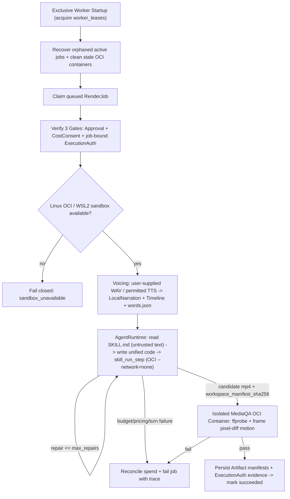

# Scenivox — Backend & Media Architecture (ADR-02 Baseline)

**Status note:** Phase 0–1 foundations (`P1-01` persistence, `P1-02` deterministic offline planner, `P1-03` review/approval, `P1-04` fail-closed render jobs, `P1-05` model registry/selection) and `P2-02` WAV/timing foundations are **implemented** at `53db65bc72b0cc37162a5bbcac3689f126cdcf97`. The AI agent runtime, skill bundle registry, Linux OCI sandbox runner (including Windows via WSL2), atomic cost-consent ledger, bound execution authorization, exclusive worker loop, and isolated MediaQA pipeline below are **ADR-02 target architecture** awaiting final PM review.

---

## 1. System Boundaries & Data Flow

```text
Future website (HOLD until CEO authorizes Phase 3)
      │ REST / job polling / safe artifact links
      ▼
┌─────────────────────────────── Rust Scenivox Core ────────────────────────────────┐
│ Axum API + Clap CLI (shared Store & domain services)                              │
│                                                                                   │
│  [Implemented]                          [Planned Phase 2 — ADR-02]                │
│  • Project / Revision / Scene CRUD      • SkillRegistry (import, hash, manifest)  │
│  • Review & hash-bound Approval         • CostConsent (atomic reserve/reconcile)  │
│  • ModelRegistry & Role Resolution      • ExecutionAuth (job + policy + evidence) │
│  • RenderJob durability & P2-02 WAV     • LlmProvider (mock / local / remote API) │
│                                         • AgentRuntime + Exclusive JobWorker      │
└────────┬─────────────────────┬──────────────────────────┬─────────────────────────┘
         │                     │                          │
    SQLite (SQLx)        Host Secrets / APIs       Linux OCI Sandbox (host / WSL2)
  metadata, ledgers,     LlmProvider & TTS         (--network=none, --read-only,
  leases, traces         (host-only, CostConsent)   --cap-drop=ALL, no sockets/secrets)
                                                          │
                         ┌────────────────────────────────┴────────────────────────┐
                         │ 1. Composition Container: SKILL.md (RO) + unified code  │
                         │    written by AgentRuntime + manifest entrypoints only  │
                         │ 2. Isolated MediaQA Container: bounded ffmpeg / ffprobe │
                         │    inspecting untrusted media outputs (RO artifact)     │
                         └────────────────────────────────┬────────────────────────┘
                                                          ▼
                         Verified final.mp4 + stills + workspace_manifest_sha256
```

**Crucial invariant:** Scenivox runs its own in-process Rust agent loop against `LlmProvider`. Claude Code, OMP, and Antigravity are development tools only and are **never** required at runtime.

---

## 2. Module Impact Assessment (from `53db65bc72b0cc37162a5bbcac3689f126cdcf97`)

| Module | Current Responsibility | ADR-02 Disposition | Planned Change |
|---|---|---|---|
| `src/json.rs`, `src/config.rs` | Strict 1 MiB duplicate-key JSON parser; env config | **Unchanged** | Preserve strict parsing and loopback bind defaults |
| `migrations/0001`–`0005` | Core metadata, projects/revisions, models, review/approval, `render_jobs` | **Unchanged** | Freeze existing migrations; add `0006+` migrations only |
| `src/domain.rs` | Strict v1 commands and immutable snapshot records | **Extend (additive)** | Add skill manifest, cost consent, execution auth, asset, artifact, worker lease, and agent trace types |
| `src/store.rs` | Transactional persistence & fail-closed job enqueue/retry | **Extend** | Replace hardcoded fail-closed stubs with real checks for assets, pinned skill bundle, atomic cost consent, job-bound execution auth, and OCI/WSL2 sandbox availability |
| `src/planner.rs` | `Planner` trait & `DeterministicMockPlanner` | **Keep + Extend** | Retain deterministic mock for CI; add `LlmProvider`-backed planner behind `CostConsent` |
| `src/voice.rs` | `NarrationProvider`/`AlignmentProvider` traits, WAV inspect, `Timeline` | **Extend** | User-supplied Indonesian WAV first (`P2-02`), then licensed local TTS/aligner evaluation + `words.json`/`timeline.json` sidecars |
| `src/db.rs` | SQLite connect, migrations, and current P1-04 `startup_interrupted` | **Extend (Phase 2)** | Move active-job interruption recovery **out of ordinary `db::connect()`** into exclusive `worker.rs` startup/lease ownership so ordinary CLI/API reads never interrupt live jobs |
| `src/api.rs`, `src/cli.rs` | Axum HTTP routes and Clap CLI commands | **Extend** | Add `/v1/skills`, `/v1/assets`, `/v1/cost-consents`, `/v1/execution-authorizations`, job trace/artifacts, and `/ready` |
| `src/skill.rs` *(new)* | — | **New** | Traversal/zip-bomb-safe skill bundle import, SHA-256 pinning, `skill.manifest.json` validation, read-only capability discovery |
| `src/provider.rs` *(new)* | — | **New** | Unified `LlmProvider` trait (tool calls, structured output, pricing/usage metadata) + `DeterministicMockLlm` + local/remote adapters |
| `src/agent.rs` *(new)* | — | **New** | Bounded agent loop (`max_turns`, `max_tool_calls`, `max_repairs`, atomic budget checks, manifest-declared tools only) |
| `src/sandbox.rs` *(new)* | — | **New** | Linux OCI container runner (native Linux or Windows via WSL2) for both skill execution and isolated `ffmpeg`/`ffprobe` MediaQA |
| `src/worker.rs` *(new)* | — | **New** | Exclusive-lease durable worker (`worker_leases`), startup recovery + orphan container/workspace cleanup, job stage execution |

---

## 3. Planned Phase 2 Execution Pipeline (ADR-02)



---

## 4. Untrusted Boundaries & OCI Sandbox Prohibitions

1. **All four inputs/outputs are untrusted:**
   - Skill bundles (`SKILL.md`, `references/`, `scripts/`)
   - Model outputs (JSON, tool arguments, generated text)
   - AI-generated JavaScript/Python composition code
   - Produced media artifacts (`final.mp4`, stills, audio mixes)
2. **Mandatory Linux OCI container baseline:**
   - MVP execution isolation is **Linux OCI containers** (native on Linux; via **WSL2** on Windows hosts). Hosts without verified OCI isolation fail closed (`503 sandbox_unavailable`).
   - **Explicitly prohibited inside any composition or MediaQA container:**
     - Host secrets, API keys, `.env` files, or `scenivox.db`
     - Docker/Podman socket mounts (`/var/run/docker.sock`, etc.)
     - `--privileged` containers or added Linux capabilities (must use `--cap-drop=ALL` and `--security-opt=no-new-privileges`)
     - Unrestricted host filesystem mounts (mount only pinned RO skill/runtime dirs, RO frozen inputs, and the dedicated RW job workspace)
     - Outbound/inbound network access (`--network=none` unconditionally during generated-code execution, rendering, and MediaQA)
3. **Isolated MediaQA:** `ffmpeg` and `ffprobe` inspection of untrusted generated media runs inside a bounded, `--network=none`, `--read-only` OCI container with CPU/RAM/time caps; Rust parses only the bounded probe JSON and sampled frame metrics.
4. **UI boundary:** Web frontend scaffolding, styling, auth, and dashboards remain strictly **on HOLD (Phase 3)** until explicit CEO authorization.
