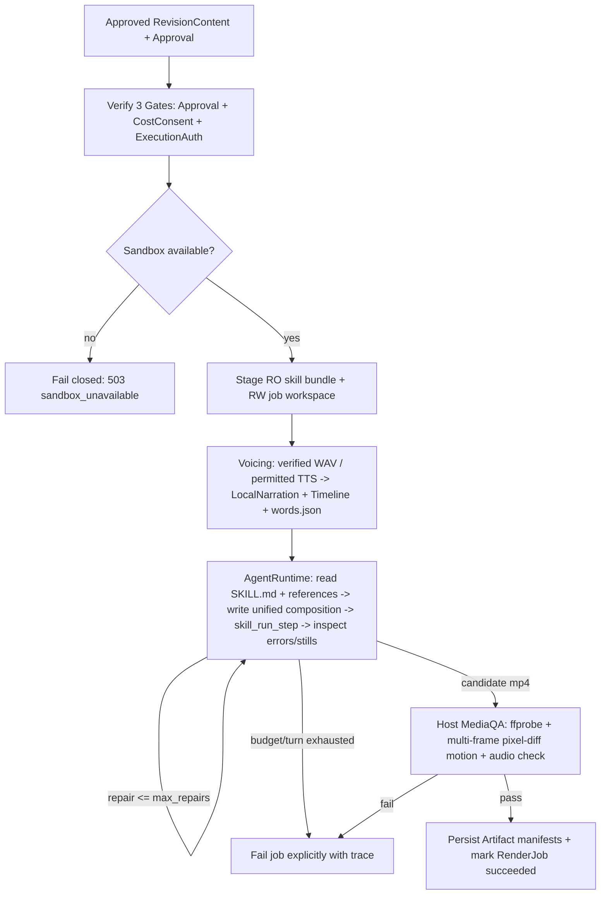

# Scenivox — Backend & Media Architecture (ADR-02 Baseline)

**Status note:** Phase 0–1 foundations (`P1-01` persistence, `P1-02` deterministic offline planner, `P1-03` review/approval, `P1-04` fail-closed render jobs, `P1-05` model registry/selection) and `P2-02` WAV/timing foundations are **implemented** at commit `53db65bc72b0cc37162a5bbcac3689f126cdcf97`. The AI agent runtime, skill bundle registry, sandbox runner, cost-consent ledger, execution authorization, worker loop, and media export pipeline described below are **ADR-02 target architecture** awaiting implementation approval.

---

## 1. System Boundaries & Data Flow

```text
Future website (HOLD until CEO authorizes Phase 3)
      │ REST / job polling / safe artifact links
      ▼
┌─────────────────────────────── Rust Scenivox Core ────────────────────────────────┐
│ Axum API + Clap CLI (shared Store & domain services)                              │
│                                                                                   │
│  [Implemented]                          [Planned Phase 2 — ADR-02]                │
│  • Project / Revision / Scene CRUD      • SkillRegistry (import, hash, manifest)  │
│  • Review & hash-bound Approval         • CostConsent & ExecutionAuth ledgers     │
│  • ModelRegistry & Role Resolution      • LlmProvider (mock / local / remote API) │
│  • RenderJob durability & recovery      • AgentRuntime (bounded loop + tools)     │
│  • P2-02 WAV validation & Timeline      • SandboxRunner + JobWorker + MediaQA     │
└────────┬─────────────────────┬──────────────────────────┬─────────────────────────┘
         │                     │                          │
    SQLite (SQLx)        Host Secrets / APIs       Fail-Closed Sandbox
  metadata, ledgers,     LlmProvider & TTS         (--network=none, RO mounts,
  traces, artifacts      (behind CostConsent)       RW job workspace, rlimits)
                                                          │
                         ┌────────────────────────────────┴────────────────────────┐
                         │ Skill-Specific Runtime inside Sandbox                   │
                         │  • SKILL.md + references/ (read-only context)           │
                         │  • Unified composition files written by AgentRuntime    │
                         │    (e.g., Node/Playwright/Canvas + Python + FFmpeg)     │
                         └────────────────────────────────┬────────────────────────┘
                                                          ▼
                         final.mp4 + stills + trace -> Host MediaQA (ffprobe + motion)
```

**Crucial invariant:** Scenivox executes its own in-process Rust agent loop against `LlmProvider`. Claude Code, OMP, and Antigravity are development tools only and are **never** required at runtime.

---

## 2. Module Impact Assessment (at `53db65bc72b0cc37162a5bbcac3689f126cdcf97`)

| Module | Current Responsibility | ADR-02 Disposition | Planned Change |
|---|---|---|---|
| `src/json.rs`, `src/config.rs` | Strict 1 MiB duplicate-key JSON parser; env config | **Unchanged** | Preserve strict parsing and loopback bind defaults |
| `migrations/0001`–`0005` | Core metadata, projects/revisions, models, review/approval, `render_jobs` | **Unchanged** | Freeze existing migrations; use additive `0006+` migrations only |
| `src/domain.rs` | Strict v1 commands and immutable snapshot records | **Extend (additive)** | Add skill manifest, cost consent, execution auth, asset, artifact, and agent trace types; keep v1 records backward-compatible |
| `src/store.rs` | Transactional persistence & fail-closed job enqueue/retry | **Extend** | Replace hardcoded fail-closed stubs with real checks for assets, pinned skill bundle, cost consent, execution auth, and sandbox availability |
| `src/planner.rs` | `Planner` trait & `DeterministicMockPlanner` | **Keep + Extend** | Retain deterministic mock for CI; add `LlmProvider`-backed planner behind `CostConsent` |
| `src/voice.rs` | `NarrationProvider`/`AlignmentProvider` traits, WAV inspect, `Timeline` | **Extend** | Keep strict WAV & provenance checks; add async/process TTS & alignment adapters and export `words.json`/`timeline.json` sidecars |
| `src/db.rs` | SQLite connect, migrations, `startup_interrupted` recovery | **Extend** | Retain job interruption recovery; add startup orphan workspace/sandbox reconciliation |
| `src/api.rs`, `src/cli.rs` | Axum HTTP routes and Clap CLI commands | **Extend** | Add `/v1/skills`, `/v1/assets`, `/v1/cost-consents`, `/v1/execution-authorizations`, job trace/artifacts, and `/ready` |
| `src/skill.rs` *(new)* | — | **New** | Traversal-safe skill bundle import, SHA-256 pinning, `skill.manifest.json` validation, read-only capability discovery |
| `src/provider.rs` *(new)* | — | **New** | Unified `LlmProvider` trait (tool calls, structured output, token/cost telemetry) + `mock` + local/remote adapters |
| `src/agent.rs` *(new)* | — | **New** | Bounded agent loop (`max_turns`, `max_tool_calls`, `max_repairs`, cost/time caps) and tool dispatcher |
| `src/sandbox.rs` *(new)* | — | **New** | Fail-closed isolated execution backend (container/namespace runner, limits, network=none, process-tree reap) |
| `src/worker.rs` *(new)* | — | **New** | Single-concurrency durable job worker executing `preparing -> voicing -> animating -> mixing -> validating` + MediaQA |

---

## 3. Implemented vs. Planned Boundaries

### Implemented Today
- **P1-01 / P1-02 / P1-03 / P1-05:** Local SQLite project CRUD, immutable copy-on-write revisions with JCS SHA-256, deterministic offline storyboard planning with frozen `PlanningProvenance`, model registry and `global < project < run` selection, and hash-bound review/approval.
- **P1-04:** Durable `render_jobs` table/triggers, startup interruption recovery, cancel/get commands, and fail-closed enqueue/retry (`skill_unavailable`, `remote_cost_not_approved`, `invalid_asset_reference`).
- **P2-02:** `scenivox voice inspect --file <relative-path>` validates user-supplied integer PCM WAV (mono/stereo, 8–192 kHz, 8/16/24/32-bit, 1–60 s, 64 MiB max) with strict normal-relative-path confinement (`""`, `.`/`./`, `..`, absolute paths, and symlink escapes rejected; opened-handle regular-file metadata check is local defense-in-depth and does not eliminate kernel-level TOCTOU/symlink races). `Timeline` remains an internal sidecar preserving `AudioProvenance` and `CaptionProvenance` (`none`, `unverified_external`, `measured_provider_alignment`); `SyntheticTestFixture` can never qualify as verified narration or measured speech alignment.

### Planned Phase 2 (ADR-02 Execution Pipeline)



---

## 4. Security Boundaries & Sandbox Isolation

1. **Untrusted inputs:** `SKILL.md`, imported bundle scripts, LLM outputs, and AI-generated JS/Python are all untrusted.
2. **No unsandboxed code execution:** Allowing AI-generated JS/Python makes host subprocess CWD/env filtering insufficient. Real execution requires `SandboxBackend::is_available() == true` (Linux/WSL2 rootless OCI container or namespaces/seccomp/cgroups with `--network=none`, `--read-only` skill/runtime mounts, bounded RW job workspace, PIDs/RAM/CPU/disk caps, and OS process-tree termination). Windows hosts without verified container/WSL2 isolation fail closed (`sandbox_unavailable`).
3. **Secret isolation:** Provider API keys and `scenivox.db` stay strictly on the Rust host. Sandbox environments receive zero credentials, zero host `.env` files, and zero outbound network access.
4. **Separate authorization gates:** Editorial approval (`Approval`), API spend permission (`CostConsent`), and sandboxed code execution (`ExecutionAuth`) are distinct records and cannot substitute for one another.

---

## 5. UI Boundary

Web frontend scaffolding, styling, auth, and dashboards remain strictly **on HOLD (Phase 3)** until explicit CEO authorization.
